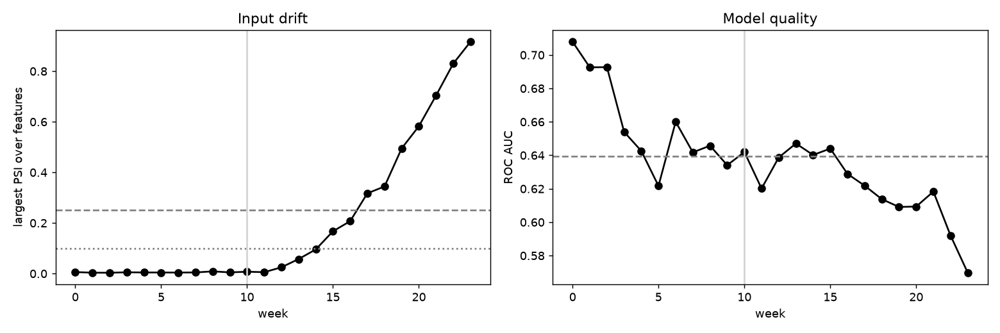

# model-drift-monitoring

Monitoring a deployed model: PSI, KS and chi-square drift tests, weekly AUC tracking and alert rules.

## Task

Notice when the input data or the relationship with the target changes, before the business notices bad predictions.

## Approach

- A 24-week stream: from week 10 income and the segment mix drift (covariate drift), from week 14 the effect of balance on the target weakens (concept drift).
- The model is trained on the first three weeks; the next three weeks give an out-of-sample baseline AUC.
- Each week is compared with the reference period using PSI (stable below 0.1, alert above 0.25), a KS test for numeric and a chi-square test for categorical features, and the model's AUC.

## Results



- Drift was injected at week 10; baseline AUC 0.639.
- The PSI alert fired in week 17 and the AUC-drop alert (0.03) in week 19.
- In the last week the largest PSI is 0.916 on `income` and AUC is 0.570.
- Weeks by status: stable 15, alert 7, warning 2.

Both alerts come several weeks after the drift starts because the shift is gradual. Smaller thresholds would fire earlier at the price of more false alarms, which is the usual trade-off.

## Run

```bash
pip install -r requirements.txt
python run.py      # generates data, runs the analysis, writes reports/
pytest             # unit tests
```

## Layout

```
src/data.py     data generation (fixed seed, no downloads)
src/core.py     analysis / model code
run.py          end-to-end script
tests/          unit tests
reports/        figures and summary.json produced by run.py
```

## Notes

The data is generated by `src/data.py` with a fixed random seed, so the numbers above are reproducible. It is synthetic: it is meant to show the method, and results on real data will differ.

Stack: pandas, scipy, scikit-learn, matplotlib.
